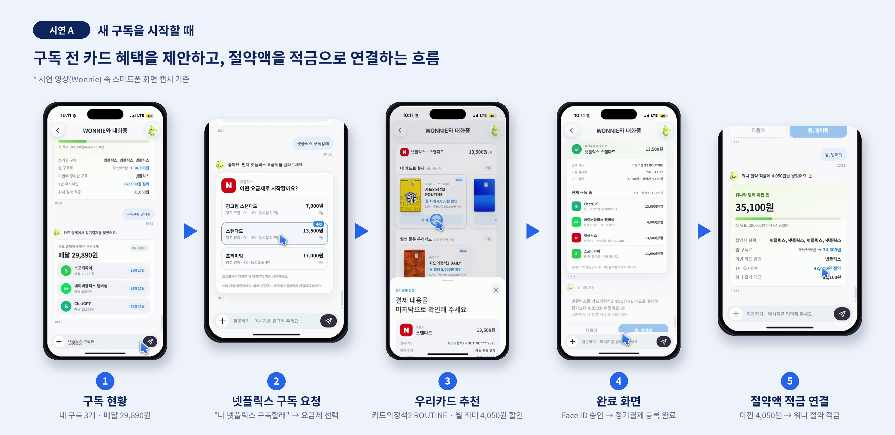
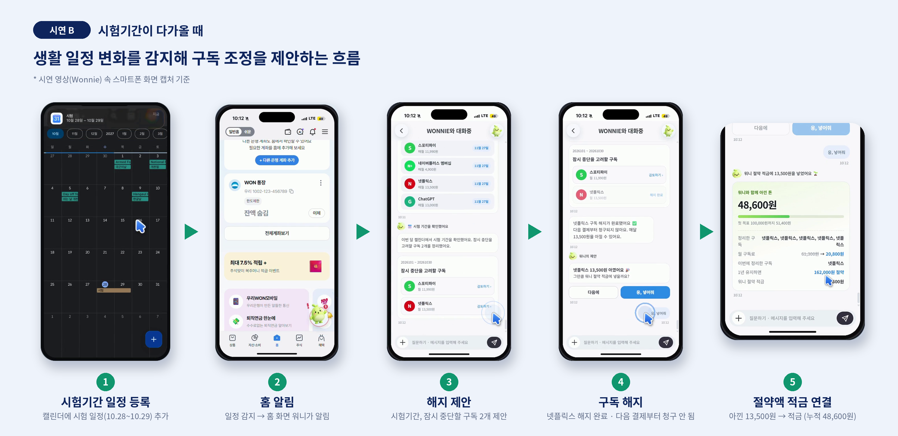

# 김수아 | 금융 AI 서비스 기획 포트폴리오

---

## 1. 소개

금융 AI 서비스 기획에 관심이 있는 개발 교육생 김수아입니다.
사용자가 이미 익숙하게 쓰는 금융 앱의 흐름 위에 AI 기능을 자연스럽게 얹는 일에 관심이 있습니다.
3일 해커톤에서 5인 팀으로 **AI 금융 비서 WONNIE**를 만들었고, 기획 단계에서 기능 아이디어를 냈습니다.
AI 코딩 도구로 서비스의 첫 화면인 홈 화면도 직접 만들었습니다.

---

## 2. 기술 사용 맥락

### 내가 직접 다룬 기술

| 기술 | 어디에 썼나 | 어떻게 썼나 |
|---|---|---|
| HTML, CSS, React | WONNIE 홈 화면 | 3일 안에 완성하기 위해 AI 코딩 도구를 활용했습니다. 기획 의도를 AI에게 설명해서 화면을 만들고, 직접 눌러보며 어색한 부분을 찾아 다시 고쳐달라고 요청했습니다. |
| AI 코딩 도구 | 홈 화면 구현 | 결과물이 실제 은행 앱처럼 보이는지, 버튼이 의도대로 움직이는지 직접 확인하며 고쳤습니다. |

### 팀 전체 기술 구조

WONNIE는 아래 구조로 만들어졌습니다. 제가 맡은 홈 화면 외의 부분은 팀원들이 구현했습니다.

| 영역 | 기술 |
|---|---|
| 화면 | React |
| 서버 | Java (Spring Boot) |
| AI 상담 | OpenAI (ChatGPT) + RAG. 준비된 자료를 찾아보고 답하게 해서 잘못된 답을 줄였습니다. |
| 데이터 저장 | MySQL, Redis |
| 로그인 | 구글 로그인 |
| 일정 연동 | 구글 캘린더. 시험 기간처럼 바쁜 일정을 찾아 그 기간에 잘 안 쓸 구독(OTT·음악 등)을 잠시 멈추라고 추천합니다. |
| 배포 | GitHub Actions, Docker, Oracle 서버로 자동 배포 |

**팀 설계 특징:** 금액 계산은 프로그램이 정확하게 하고, AI는 그 결과를 설명만 하도록 역할을 나눴습니다. AI가 틀린 숫자를 말하지 않게 하려는 설계입니다.

---

## 3. 대표 프로젝트: WONNIE

**구독 관리부터 저축까지, AI 금융 비서 WONNIE**

| 항목 | 내용 |
|---|---|
| 기간 | 2026.10.26 ~ 10.28 (3일 해커톤) |
| 상태 | 발표 완료 |
| 팀 | 5인 |
| 내 역할 | 기획(기능 아이디어 제안), 프론트엔드(홈 화면), 시연 영상 제작 |

### 대상과 문제

- **대상:** AI·OTT·쇼핑 구독을 5개 이상 쓰는 20대 직장인
- **문제**
  - 구독은 1인 평균 5.5개, 한 달에 약 4만 원이 나갑니다.
  - 무료체험이 끝나면 그대로 유료로 넘어가는 경우가 많습니다 (56%).
  - 해지가 번거로워 58.4%가 불편을 겪었고, 그중 52.4%는 해지 메뉴조차 찾지 못했습니다.
  - 어떤 카드 혜택을 받을 수 있는지 몰라서 정기 지출이 계속 쌓입니다.

### 해결 방향

WONNIE는 구독 현황을 한곳에서 보여주고, 새 구독은 할인 카드로 더 싸게 시작하게 하며, 안 쓰는 구독은 채팅으로 해지하도록 돕습니다. 이렇게 아낀 돈은 적금으로 모읍니다.

---

## 4. 개인 기여

### ① 기획: 기능 아이디어 제안

팀 회의에서 세 가지 기능 아이디어를 냈고, 팀원들과 함께 서비스에 담았습니다.

| 아이디어 | 내용 | 연결되는 문제 |
|---|---|---|
| 할인 카드 추천 | 새 구독을 시작할 때 할인받을 수 있는 카드를 먼저 알려줍니다 | 카드 혜택을 몰라서 쌓이는 정기 지출 |
| 아낀 돈 적금 | 카드 할인이나 해지로 아낀 돈을 적금에 넣습니다 | 아낀 돈이 다시 흩어지지 않고 저축으로 이어지게 |
| 은행 앱 같은 홈 화면 | 홈 화면을 실제 우리WON뱅킹처럼 꾸밉니다 | 사용자가 처음 보는 서비스도 익숙하게 느끼도록 |

### ② 프론트엔드: WONNIE 홈 화면 구현 (HTML, CSS, React)

실제 우리WON뱅킹 앱처럼 보이도록 서비스의 첫 화면을 구성했습니다.

- **맨 위:** 넘겨볼 수 있는 이벤트 배너
- **가운데:** 내 통장 잔액 카드(잔액 숨기기·보이기, 계좌번호 복사), 다른 은행 계좌, 금융 서비스 소개 카드, 우리금융그룹 서비스(카드·증권 등)
- **맨 아래:** 메뉴 탭
- **화면 연결:** 홈 화면의 'AI 상담' 버튼을 누르면 워니 채팅 화면으로 넘어갑니다.
- **시연 안정성:** 아직 만들지 않은 메뉴를 누르면 "준비 중이에요" 안내 문구가 뜹니다. 시연 중 화면이 멈추지 않게 하려고 넣었습니다.

**작업 방식:** 기획 의도를 AI 코딩 도구에 설명해 화면을 만들고, 직접 눌러보며 어색한 부분을 찾아 다시 고쳐달라고 요청하는 과정을 반복해 완성도를 높였습니다.

### ③ 시연 영상 제작

심사위원이 서비스 흐름을 한눈에 이해할 수 있도록 두 가지 상황을 영상으로 담았습니다. 아래 화면은 시연 영상 속 스마트폰 화면을 캡처한 것입니다.

#### 시연 A. 새 구독을 시작할 때

구독 전에 카드 혜택을 제안하고, 아낀 돈을 적금으로 연결하는 흐름입니다.

| 단계 | 화면 | 내용 |
|---|---|---|
| 1 | 구독 현황 | 내 구독 3개, 매달 29,890원 |
| 2 | 넷플릭스 구독 요청 | "넷플릭스 구독할래" 입력 후 요금제 선택 |
| 3 | 우리카드 추천 | 카드의정석2 ROUTINE, 월 최대 4,050원 할인 |
| 4 | 완료 화면 | Face ID 승인 후 정기결제 등록 완료 |
| 5 | 절약액 적금 연결 | 아낀 4,050원을 워니 절약 적금에 입금 |

#### 시연 B. 시험기간이 다가올 때

생활 일정 변화를 감지해 구독 조정을 제안하는 흐름입니다.

| 단계 | 화면 | 내용 |
|---|---|---|
| 1 | 시험기간 일정 등록 | 캘린더에 시험 일정(10.28~10.29) 추가 |
| 2 | 홈 알림 | 일정을 감지해 홈 화면에서 워니가 알림 |
| 3 | 해지 제안 | 시험기간 동안 잠시 중단할 구독 2개 제안 |
| 4 | 구독 해지 | 넷플릭스 해지 완료, 다음 결제부터 청구되지 않음 |
| 5 | 절약액 적금 연결 | 아낀 13,500원을 적금에 입금 (누적 48,600원) |

---

## 5. 근거

| 근거 | 무엇을 보여주나 |
|---|---|
| 발표자료 PDF | 문제 정의, 서비스 구조, 남은 한계 |
| GitHub 저장소 ([github.com/nakknock2/wonnie](https://github.com/nakknock2/wonnie)) | 홈 화면 코드, 팀 전체 코드 |
| 시연 영상 | 두 가지 시연 시나리오, 홈 화면 동작 |

### 시연 범위

해커톤 결과물이라 실제 서비스와 다른 부분이 있습니다.

- **실제 금융 데이터와 연결하지 않았습니다.** 해커톤 기간에는 실제 고객의 금융 정보를 쓸 수 없어서, 예시 고객 1명의 데이터(구독 7개, 카드 2개, 결제 기록 184건)를 직접 만들어 사용했습니다.
- **해지·결제는 시연용 흐름입니다.** 구독 해지, 카드 발급, 적금 입금, Face ID 승인은 화면에서 흐름만 보여주고 실제로 처리되지는 않습니다. 실제로 하려면 넷플릭스 같은 서비스, 카드사, 은행과 직접 연결하고 본인 인증 절차를 붙여야 합니다.

---

## 6. 배운 점과 개선 계획

### 배운 점

#### AI가 만들어도 확인은 제 몫이었습니다

3일 안에 홈 화면을 끝내려고 AI 코딩 도구를 썼습니다. 하지만 은행 앱처럼 보이는지, 버튼을 눌렀을 때 제대로 넘어가는지는 직접 눌러보기 전까지 알 수 없었습니다. 어색한 곳이 보일 때마다 다시 고쳐달라고 했고, 그러려면 원하는 화면이 제 머릿속에 먼저 분명해야 했습니다.

#### 새 기능일수록 익숙한 화면에서 시작하고 싶었습니다

구독 관리나 아낀 돈 적금은 사용자에게 처음 보는 기능일 수 있습니다. 그래서 홈 화면을 실제 우리WON뱅킹처럼 꾸미자고 제안했고, 그 화면을 직접 만들었습니다. 잔액 카드, 계좌번호 복사, 아래 메뉴 탭처럼 은행 앱에서 늘 보던 요소를 하나씩 옮기면서, 새로운 서비스도 사용자가 이미 아는 화면 위에 있어야 덜 어색하다고 생각하게 됐습니다.

### 개선 계획

실제 서비스로 만들려면 남은 과제가 있습니다. 발표 때 팀이 함께 정리한 내용입니다.

| 남은 과제 | 개선 방향 |
|---|---|
| 우리카드 결제 내역만 볼 수 있다는 전제라 다른 카드로 낸 구독을 놓칠 수 있습니다 | 우리카드 외 다른 카드의 결제 내역도 함께 볼 수 있어야 합니다 |
| AI를 24시간 계속 돌리면 비용이 많이 듭니다 | 얼마나 자주 확인할지 기준을 정해야 합니다 |
| 금융 정보를 안내하는 AI라 잘못된 말을 할 위험이 있습니다 | 한 번 더 검사하는 장치와 기록을 남기는 장치가 더 필요합니다 |
